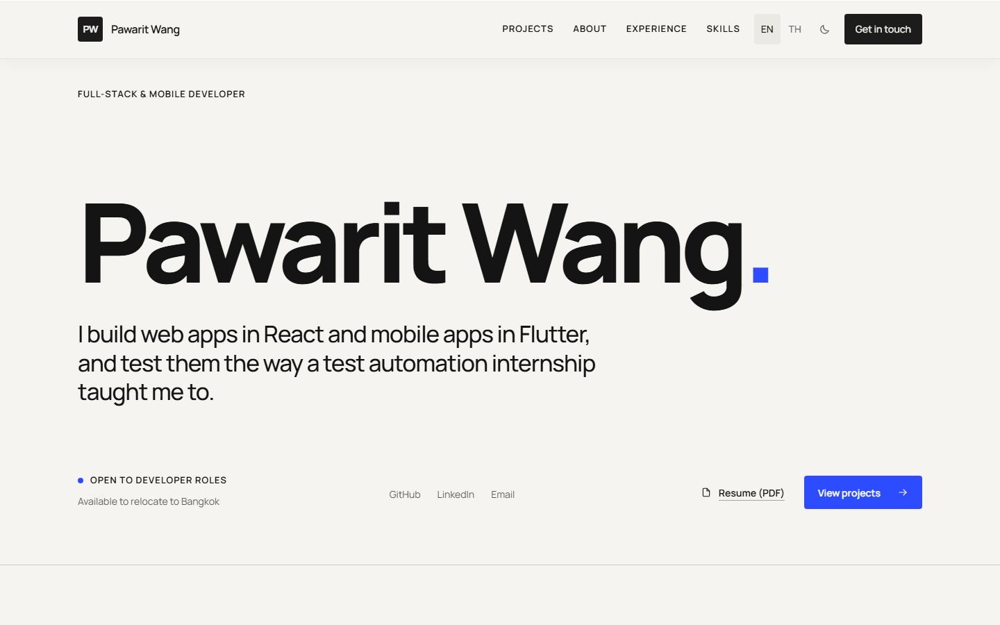

# Pawarit Wang — Portfolio

**Live: [pawarit-wang.vercel.app](https://pawarit-wang.vercel.app)**

My portfolio as a full-stack and mobile developer, built with the stack my
résumé lists: **Next.js 16 (App Router), React, TypeScript and Tailwind CSS v4**.



## What is in it

- **One page, two languages.** English and Thai each have their own URL
  (`/en`, `/th`), both prerendered. Both language files are typed against one
  `Content` type, so a field missing from either one fails the build.
- **Projects as cards.** Each project shows its screenshots in a strip that
  scrolls sideways and opens full size in a `<dialog>` viewer, with keyboard
  and Escape support.
- **A role variant.** `/[locale]/for/dba` reframes the same content for
  database roles and hands out a different CV. It is `noindex` and kept out of
  the sitemap.
- **A working contact form.** A Route Handler validates the input, rate-limits,
  drops honeypot submissions and sends through [Resend](https://resend.com).
  If delivery fails, the visitor gets a mail link and a copy button instead,
  and keeps what they typed.
- **SEO.** Metadata and hreflang per page, JSON-LD `Person`, `sitemap.xml`,
  `robots.txt`, and a generated Open Graph image per language.
- **Light and dark themes**, semantic colour tokens, visible focus, and reduced
  motion respected throughout.

## Run it locally

```bash
npm install
```

```bash
npm run dev
```

Open <http://localhost:3000>. `npm run build` makes a production build and
`npm run lint` runs ESLint.

The contact form needs Resend to send mail. Copy `.env.example` to
`.env.local` and fill in `RESEND_API_KEY`, `CONTACT_TO_EMAIL` and
`CONTACT_FROM_EMAIL`. Without them the form still works and shows the fallback.
On Vercel, set the same variables in the project settings.

## Where things live

| Path | What it holds |
| --- | --- |
| `lib/content/en.ts`, `th.ts` | Every sentence on the site, one file per language |
| `lib/content/shared.ts` | Email, phone, social links and the PDF paths |
| `lib/content/variants.ts` | The `/for/dba` role variant |
| `components/` | One component per section, plus the header, footer and viewer |
| `app/globals.css` | Design tokens and all styles |
| `app/api/contact/route.ts` | The contact form handler |
| `public/projects/` | Screenshots, one folder per project (see its README) |
| `public/documents/` | Résumés and transcript |

A new screenshot goes in `public/projects/<slug>/`, in that project's `screens`
in both language files, and in the import map at the top of
`components/projects.tsx`, which gives it its size and blur placeholder.

Design decisions are written up in [`DESIGN.md`](DESIGN.md).
